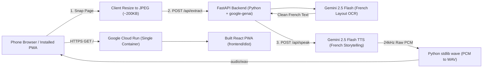

# Feasibility Assessment & Implementation Plan: French Story Reader PWA

## 1. Goal Description
Build a minimal, mobile-first Progressive Web App (**PWA**) that enables a non-French-speaking parent to read physical French children's books aloud to their kids:
1. Snap a photo of a book page using the phone's native camera.
2. Automatically extract the French story text in the proper reading order (handling illustrated layouts, whimsical fonts, and two-page spreads).
3. Synthesize warm, natural, fluent French narration and play it back cleanly with minimal UI.

The app uses **Pixi** to manage both the **Python (FastAPI)** backend and **Node.js (Vite/React)** frontend in one reproducible workspace, and packages into a single **Google Cloud Run** container so your phone loads both the PWA and API over HTTPS from one URL.

---

## 2. Feasibility Assessment

### Overall Verdict: **Highly Feasible (Low Risk, High Quality, Very Low Cost)**
Two recent AI advances make this dramatically easier and better than it was even 2 years ago:
1. **Multimodal LLMs replace brittle OCR**: Traditional OCR (e.g., Tesseract) struggles with children's books because of stylized fonts, curved text, busy artwork, speech bubbles, and two-page spreads. `gemini-2.5-flash` understands page layout, reads left-to-right across spreads, ignores page numbers/ISBNs, rejoins hyphenated words, and preserves French diacritics (`é, è, ê, ç, œ`) and dialogue punctuation (`« »`).
2. **Prompt-steered Neural TTS**: Dedicated Gemini TTS (`gemini-2.5-flash-preview-tts`) produces natural French pronunciation (including proper *liaisons* and intonation) and can be steered via prompt instructions to adopt a calm, warm, expressive bedtime storytelling tone—all using your existing `GEMINI_API_KEY`.

### Key Dimensions

| Dimension | Assessment | Details & Mitigation |
| :--- | :--- | :--- |
| **OCR Accuracy (Kids' Books)** | **Excellent** | `gemini-2.5-flash` handles stylized fonts, angled shots, and dim bedroom lighting well. Client-side resizing to `~1400px` JPEG keeps uploads fast (~200KB) without losing legibility. |
| **French Voice Quality** | **Excellent** | `gemini-2.5-flash-preview-tts` supports natural French prosody and expressive pacing. Python's stdlib `wave` module wraps raw 24kHz PCM into `.wav` in ~5 lines. |
| **Page-to-Audio Latency** | **~3–6 seconds** | Image compress (`<0.2s`) → Vision extraction (`1–2s`) → TTS synthesis (`2–4s`). Splitting `/api/extract` and `/api/speak` shows immediate progress (`Reading page...` → `Generating voice...`). |
| **Operating Cost** | **~$0.00 – $0.05 / book** | A 24-page picture book (~600 words, ~3–4 min audio) costs ~$0.002 for Vision + ~$0.05 for TTS (or **$0** on Gemini AI Studio free tier). Cloud Run scales to zero when idle (**$0/mo** free tier). |
| **Mobile Camera & Audio** | **Manageable** | `<input type="file" accept="image/*" capture="environment">` uses the phone's native camera (better autofocus & low-light night mode). Serving WAV audio via native HTML5 `<audio>` works across iOS Safari and Android Chrome. |
| **Cloud Security** | **Protected** | `GEMINI_API_KEY` stays strictly on the Cloud Run backend. An optional `APP_PIN` environment variable locks `/api/*` behind a simple one-time family passcode stored in your phone's browser. |

### Architecture Overview

---

## 3. User Review Required

> [!IMPORTANT]
> **Pixi Installation**: `pixi` is not currently installed on this machine. When you approve the plan, I will install `pixi` (or ask if you prefer installing it yourself) so `pixi run ...` manages both Python and Node.js cleanly.

> [!IMPORTANT]
> **Environment Variables (`.env`)**: You will add your `GEMINI_API_KEY` (and optionally an `APP_PIN` for Cloud Run protection) into `.env` before running live end-to-end tests or deploying.

---

## 4. Proposed Changes

We will scaffold the project in `/home/rrabadan/work/private/myapp` with Pixi at the root, the Python FastAPI service in `backend/`, the React/Vite PWA in `frontend/`, and a multi-stage `Dockerfile` for Cloud Run.

### Workspace & Dual-Runtime Management (Pixi)
#### [NEW] [pixi.toml](file:///home/rrabadan/work/private/myapp/pixi.toml)
- Conda dependencies (`conda-forge`): `python >=3.12,<3.13`, `nodejs >=22`
- PyPI dependencies: `fastapi`, `uvicorn[standard]`, `google-genai`, `python-multipart`, `python-dotenv`, `pytest`, `httpx`
- Unified tasks:
  - `pixi run install-frontend` (`npm --prefix frontend install`)
  - `pixi run dev-backend` (`uvicorn backend.main:app --reload --host 0.0.0.0 --port 8000`)
  - `pixi run dev-frontend` (`npm --prefix frontend run dev`)
  - `pixi run build-frontend` (`npm --prefix frontend run build`)
  - `pixi run test` (`pytest backend/tests`)
  - `pixi run start` (`uvicorn backend.main:app --host 0.0.0.0 --port 8080`)

#### [NEW] [.env.example](file:///home/rrabadan/work/private/myapp/.env.example)
- Documents `GEMINI_API_KEY`, optional `GEMINI_VOICE=Aoede`, and optional `APP_PIN`.

#### [NEW] [.gitignore](file:///home/rrabadan/work/private/myapp/.gitignore)
- Ignores `.env`, `.pixi/`, `frontend/node_modules/`, `frontend/dist/`, `__pycache__/`.

---

### Python Backend (`backend/`)
#### [NEW] [backend/wav_utils.py](file:///home/rrabadan/work/private/myapp/backend/wav_utils.py)
- Pure helper `pcm_to_wav(pcm_bytes: bytes, sample_rate: int = 24000, channels: int = 1, sample_width: int = 2) -> bytes` using Python's built-in `wave` and `io.BytesIO` modules.

#### [NEW] [backend/gemini_service.py](file:///home/rrabadan/work/private/myapp/backend/gemini_service.py)
- Uses `google.genai.Client()` (automatically reading `GEMINI_API_KEY`).
- `extract_french_text(image_bytes: bytes, mime_type: str) -> str`:
  - Calls `gemini-2.5-flash` with a tailored French children's book OCR prompt:
    - Extracts *only* the story/dialogue text in natural reading order (left page → right page).
    - Omits page numbers, headers, footers, ISBNs, and publisher marks.
    - Rejoins words hyphenated across line breaks.
    - Preserves French accents (`é, è, ê, ç, œ`) and punctuation (`« »`, `!`, `?`).
    - Returns an empty string for illustration-only pages.
- `synthesize_french_speech(text: str, voice_name: str = "Aoede") -> bytes`:
  - Calls `gemini-2.5-flash-preview-tts` with `response_modalities=["AUDIO"]`, `PrebuiltVoiceConfig(voice_name=voice_name)`, and a French storytelling prompt (*warm, calm, clear, expressive bedtime reading pace*).
  - Wraps the returned 24kHz PCM audio bytes into a standard `.wav` payload via `pcm_to_wav`.

#### [NEW] [backend/main.py](file:///home/rrabadan/work/private/myapp/backend/main.py)
- FastAPI application with:
  - Optional `APP_PIN` dependency (`X-App-Pin` header check when `APP_PIN` is set in env; no-op when unset for frictionless local dev).
  - `GET /api/health` → `{ "status": "ok", "api_key_configured": bool, "pin_required": bool }`
  - `POST /api/extract` → accepts `UploadFile` (`image/*`, max 10MB), returns `{ "text": str }`
  - `POST /api/speak` → accepts JSON `{ "text": str, "voice"?: str }`, returns `Response(content=wav_bytes, media_type="audio/wav")`
  - Serves `frontend/dist` static assets and `index.html` fallback when the production build exists (single-origin Cloud Run deployment).

#### [NEW] [backend/tests/test_api.py](file:///home/rrabadan/work/private/myapp/backend/tests/test_api.py)
- Pytest suite testing:
  - `pcm_to_wav` header & payload validity (readable by `wave.open`).
  - `/api/health`, `/api/extract`, `/api/speak` happy paths and validation errors using mocked Gemini service.
  - `APP_PIN` authorization enforcement (401 when wrong/missing, 200 when valid).

---

### Mobile-First PWA Frontend (`frontend/`)
#### [NEW] [frontend/package.json](file:///home/rrabadan/work/private/myapp/frontend/package.json) & [frontend/vite.config.ts](file:///home/rrabadan/work/private/myapp/frontend/vite.config.ts)
- Minimal React 19 + Vite + TypeScript setup.
- `vite.config.ts` sets `server.host: true` (for local Wi-Fi phone testing) and proxies `/api` → `http://127.0.0.1:8000`.

#### [NEW] [frontend/public/manifest.json](file:///home/rrabadan/work/private/myapp/frontend/public/manifest.json)
- PWA manifest (`display: "standalone"`, app name **"Conte"**, warm dark bedtime theme color).

#### [NEW] [frontend/src/utils/image.ts](file:///home/rrabadan/work/private/myapp/frontend/src/utils/image.ts)
- Client-side `<canvas>` resize/JPEG compressor (`maxDimension = 1400`, `quality = 0.82`) shrinking 12MP phone photos from ~5MB to ~200KB before upload.

#### [NEW] [frontend/src/App.tsx](file:///home/rrabadan/work/private/myapp/frontend/src/App.tsx) & [frontend/src/index.css](file:///home/rrabadan/work/private/myapp/frontend/src/index.css)
- Minimal, low-glare bedtime-friendly mobile UI:
  - Large **"Scan Page"** button launching the native camera (`<input type="file" accept="image/*" capture="environment">`).
  - Two-stage status indicator (`Reading page...` → `Generating voice...`) and friendly message if a page has no text.
  - Clean audio player: large Play/Pause button, Replay button, progress bar, and `0.85x / 1.0x` reading speed toggle.
  - Hidden-by-default collapsible `"Show text"` toggle (just in case you want to check the extracted French text).
  - One-time PIN prompt screen if the backend reports `pin_required: true`.

---

### Cloud Run Deployment
#### [NEW] [Dockerfile](file:///home/rrabadan/work/private/myapp/Dockerfile) & [.dockerignore](file:///home/rrabadan/work/private/myapp/.dockerignore)
- Multi-stage Docker build:
  1. `node:22-slim` stage builds `frontend/dist`.
  2. `python:3.12-slim` stage installs backend dependencies, copies `backend/` and `frontend/dist`, and runs `uvicorn backend.main:app --host 0.0.0.0 --port ${PORT:-8080}`.
- Deployable to Google Cloud Run in a single command (`gcloud run deploy conte --source . --region europe-west1 --allow-unauthenticated --set-env-vars GEMINI_API_KEY=...,APP_PIN=...`).

---

## 5. Verification Plan

### Automated Tests
1. **Backend tests**: Run `pixi run test` (executes `pytest backend/tests`) to verify WAV encoding, API routes, input validation, and `APP_PIN` protection.
2. **Frontend type-check & production build**: Run `pixi run build-frontend` to verify TypeScript compilation and Vite bundling succeed cleanly.

### Manual Verification
1. Add your `GEMINI_API_KEY` to `.env` and start locally (`pixi run dev-backend` + `pixi run dev-frontend`, or build once and run `pixi run start`).
2. Open the app on your browser or phone over Wi-Fi.
3. Snap/upload a photo of a French children's book page and confirm:
   - Status transitions cleanly from `Reading page...` to `Generating voice...`.
   - Warm, fluent French audio plays with working Play/Pause, Replay, and `0.85x / 1.0x` speed controls.
   - An illustration-only page shows a friendly "No text found" message.
4. (Optional) Deploy to Google Cloud Run and test "Add to Home Screen" on your phone over HTTPS.
